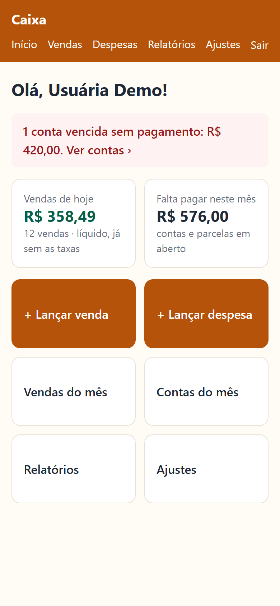
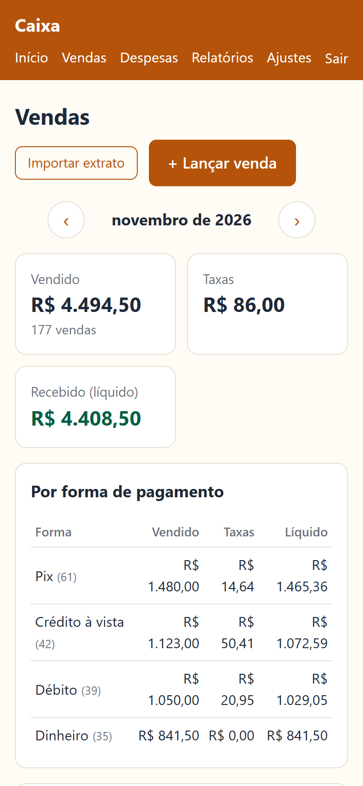
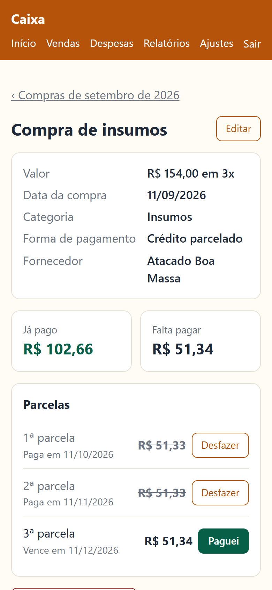
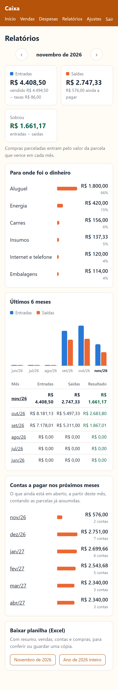
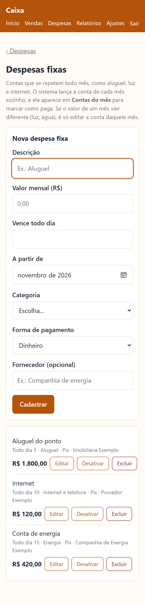
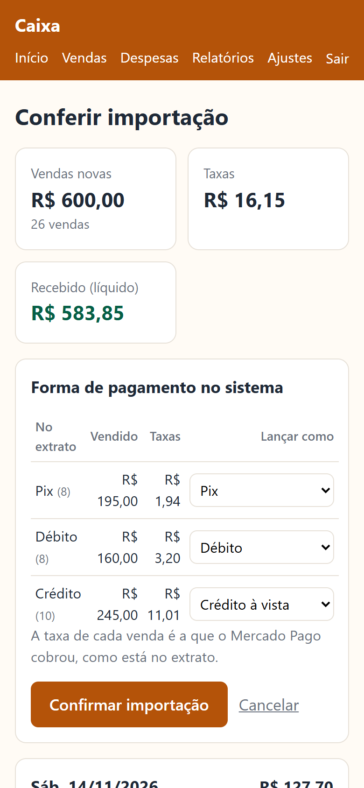

# Caixa da Pastelaria

Sistema web para controlar **vendas, despesas e contas a pagar** de um pequeno comércio de alimentação
(pastelaria e espetaria). Nasceu para substituir o caderno de papel de uma família: precisava ser simples
o bastante para quem não é técnico e funcionar bem no celular.

> Este repositório usa **somente dados fictícios**. O comando `flask dados-demo` cria um banco de exemplo para
> você explorar o sistema.

<p>
  
  
  
</p>

## O que o sistema faz

- **Vendas:** lançamento manual com taxa da maquininha calculada automaticamente por forma de pagamento
  (dinheiro, Pix, débito, crédito) e resumo do mês.
- **Importação de extrato:** lê o CSV de vendas do Mercado Pago, mostra uma prévia para conferência e grava
  sem duplicar (cada venda é identificada pelo `PAYMENT_ID`). A taxa real de cada venda vem do extrato.
- **Despesas e parcelas:** compras à vista ou parceladas; cada parcela vira uma conta do mês, com botão
  "Paguei" e aviso de contas vencidas.
- **Despesas fixas:** aluguel, energia, internet... são lançadas sozinhas mês a mês, e o valor de cada mês
  pode ser ajustado sem perder o padrão.
- **Relatórios:** entradas, saídas e sobra por mês (regime de caixa: compra parcelada conta pela parcela
  que vence no mês), gastos por categoria, gráfico dos últimos 6 meses e contas dos próximos meses.
- **Planilha Excel** do mês ou do ano, para conferência e cópia de segurança.
- **Assistente "Perguntar"** (opcional): perguntas em português sobre o caixa, respondidas pela API da
  Anthropic com consultas **somente leitura**. Só aparece se `ANTHROPIC_API_KEY` estiver configurada.
- **Segurança básica:** login obrigatório (sem cadastro aberto), senhas com hash, proteção CSRF e bloqueio
  temporário após tentativas erradas.

<p>
  
  
  
</p>

## Tecnologias

Python 3.11 · Flask · SQLAlchemy · Flask-Migrate (Alembic) · Flask-Login · Flask-WTF · SQLite (MySQL opcional)
· openpyxl (Excel) · Jinja2 + CSS próprio (mobile-first, com manifest para adicionar à tela inicial do celular)
· pytest

## Rodar no computador (com dados fictícios)

Precisa do [Python 3.10 ou mais novo](https://www.python.org/downloads/) (na instalação, marque
"Add python.exe to PATH").

**1. Baixe o código** para uma pasta de caminho curto, como `C:\projetos`: botão **Code → Download ZIP**
(e extraia) ou

```powershell
git clone https://github.com/Moura1106/pastelaria.git C:\projetos\pastelaria
```

**2a. Jeito mais fácil (Windows):** dê dois cliques em **`iniciar_demo.bat`**. Na primeira vez ele cria o
ambiente, instala as bibliotecas e monta o banco de exemplo (leva alguns minutos); depois só liga o servidor.
O navegador abre sozinho na tela de login.

**2b. Ou passo a passo** (PowerShell, dentro da pasta do projeto):

```powershell
python -m venv .venv
.\.venv\Scripts\pip install -r requirements.txt
.\.venv\Scripts\flask db upgrade    # cria as tabelas
.\.venv\Scripts\flask dados-demo    # usuário, vendas, despesas e um extrato CSV falso
.\.venv\Scripts\flask run
```

Abra http://127.0.0.1:5000 e entre com `demo@exemplo.com` / `demo12345`.

O arquivo `.env` é opcional para testar no computador; para publicar, copie `.env.exemplo` para `.env` e
defina uma `SECRET_KEY` própria (veja o [DEPLOY.md](DEPLOY.md)).

O `dados-demo` também grava `demo/extrato_mercado_pago_demo.csv`: use-o em **Vendas → Importar extrato**
para testar a importação. O comando recusa rodar se o banco já tiver dados, para nunca misturar a demonstração
com informações reais.

No Linux/macOS, troque `.\.venv\Scripts\` por `.venv/bin/`.

### Se der erro

- **`No such file or directory` / aviso sobre "Long Path" no `pip install`:** o caminho da pasta é longo
  demais para o Windows. Mova o projeto para algo como `C:\projetos\pastelaria`, apague a pasta `.venv` e rode
  de novo.
- **`No such command 'db'` ou `'dados-demo'`:** as bibliotecas não foram instaladas (veja o erro do
  `pip install`) ou o comando foi rodado fora da pasta do projeto.
- **`python` não é reconhecido / abre a Microsoft Store:** instale o Python pelo site e marque
  "Add python.exe to PATH".

## Comandos

| Comando | O que faz |
|---|---|
| `flask db upgrade` | Aplica as migrações no banco |
| `flask db migrate -m "..."` | Gera migração depois de mudar `app/models.py` |
| `flask dados-demo` | Popula um banco vazio com dados fictícios |
| `flask dados-iniciais` | Cadastra só as categorias e formas de pagamento padrão |
| `flask criar-usuario` | Cria um login (não há cadastro aberto no site) |
| `flask trocar-senha` | Troca a senha de um usuário |
| `flask backup` | Copia o banco SQLite para a pasta de backups |

## Testes

```powershell
.\.venv\Scripts\pip install pytest
.\.venv\Scripts\python -m pytest
```

São 96 testes automatizados (login, vendas, despesas, parcelas, despesas fixas, relatórios, importação de
extrato, planilha, backup, assistente e dados de demonstração).

## Estrutura

- `app/models.py` — tabelas (usuários, categorias, formas de pagamento, receitas, despesas, parcelas, fixas)
- `app/receitas.py`, `app/despesas.py`, `app/fixas.py` — telas e regras de vendas, despesas e contas fixas
- `app/importacao.py` — leitura do extrato CSV do Mercado Pago
- `app/relatorios.py`, `app/planilha.py` — relatórios e exportação para Excel
- `app/assistente.py` — assistente de IA com ferramentas somente leitura
- `app/demo.py` — gerador de dados fictícios
- `migrations/` — histórico de mudanças do banco (Alembic)
- `tests/` — testes com pytest

## Publicação

O guia [DEPLOY.md](DEPLOY.md) descreve como publicar no PythonAnywhere (conta gratuita, SQLite, backup
automático no primeiro acesso do dia).
